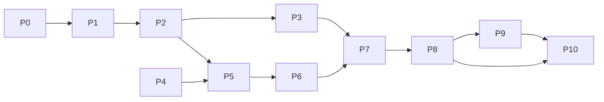

# Implementation plan: Dynamic Form Renderer

| | |
| --- | --- |
| Status | Approved |
| Version | 0.1 |
| Date | 2026-11-13 |
| Owner | Dariush Hadipour |
| Inputs | [prd.md](prd.md), [tdd.md](tdd.md), [adr/](adr/README.md), [api-contract.md](api-contract.md), [test-strategy.md](test-strategy.md), [test-cases.md](test-cases.md), [traceability-matrix.md](traceability-matrix.md) |
| Structure based on | Vertical slices with a walking skeleton; a work breakdown with entry and exit criteria per phase |

---

## 0. Version history

| Version | Date | Change |
| --- | --- | --- |
| 0.1 | 2026-11-13 | First draft. |

## 1. Working agreement

1. **Order:** phases run in the order below; each ends with `check` green, the phase's test cases passing, the matrix rows set to Passing, and a short note of files changed and decisions made.
2. **Review gate:** work stops at each phase boundary for review. After approval, the phase is committed locally in small commits (Conventional Commits). Nothing is pushed without an explicit go-ahead at the very end.
3. **Tests:** test-first for pure logic (phases 1 to 3); in the same commit as the feature everywhere else.
4. **Scope control:** nothing outside the PRD is added. A new dependency or a deviation from an ADR needs a new or superseding ADR first.
5. **Commit identity:** author and committer are the developer; commit messages carry no tool attribution.

## 2. Phase overview

| Phase | Name | Main output | Est. hours | Priority |
| --- | --- | --- | --- | --- |
| 0 | Tooling and skeleton | Empty app with every gate, CI and the test shim | 2 | Must |
| 1 | Core helpers | Sizes, numbers, accept matching, file list | 1 | Must |
| 2 | Kinds, normalizer, encoding | Canonical model, five kind definitions, normalizer, form-data, server-error parser | 2.5 | Must |
| 3 | Messages and resolver | Persian catalog, values schema, resolver | 1.5 | Must |
| 4 | UI layer | Tokens and primitives, logical CSS only | 1.5 | Must |
| 5 | Simple field components | Text, number, textarea, select | 1.5 | Must |
| 6 | File field | Hidden native input, list, thumbnails, remove, keyboard | 2 | Must |
| 7 | Engine | `DynamicForm`, focus, submit outcomes, success panel, states | 2.5 | Must |
| 8 | API, mocks, app | Client, queries, handlers, fixtures, pages, error boundary | 2.5 | Must |
| 9 | Playground | JSON editor view with presets and dry run | 1 | Should |
| 10 | Hardening and handover | Accessibility suite, budgets, README, manual checks, final gates | 2 | Must |
| 11 | Extras | Upload progress, conditional visibility | n/a | Could |

Total of the Must and Should phases: about 20 hours of focused work. These are estimates, to be corrected after phase 2.

### 2.1 Cut line if time is short

Cut in this order, never touching a Must: phase 9 (Playground); `pattern` (FR-22); re-selection de-duplication (FR-27); `disabled` and `readOnly` (FR-12); descriptions and default values (FR-11). Each cut is a one-line change in the PRD's scope table and the matrix.

### 2.2 Dependency order

Phase 4 can run any time after phase 0; it is placed before 5 because the components need the primitives.

---

## 3. Phases

### Phase 0: Tooling and skeleton

| | |
| --- | --- |
| Objective | A runnable empty app on which every quality gate already works. |
| Files | `package.json`, `tsconfig.json`, `vite.config.ts`, `index.html` (`lang="fa" dir="rtl"`), `.oxlintrc.json` with boundary overrides, `.stylelintrc.json`, `.prettierrc.json`, `.prettierignore`, `.husky/pre-commit`, `.lintstagedrc.json`, `.github/workflows/ci.yml`, `.gitignore`, `public/mockServiceWorker.js`, `src/main.tsx`, `src/test/setup.ts`, `src/test/undici-globals.ts`, lint and style fixtures |
| Depends on | Approved documents |
| Verifications (ADR follow-ups) | Whether the stock zod resolver can carry issue params (ADR-0003, R-1); that the boundary rules fire on fixtures (ADR-0007); that `check` passes under npm and pnpm (ADR-0012) |
| Tests | TC-S01, TC-S02, TC-S03, TC-S04, TC-S07, TC-S08, TC-S10 |
| Acceptance | `check` passes from a clean install under npm and pnpm; a staged bad stylesheet blocks a commit; the shim self-test passes; CI file present |
| Suggested commits | `chore: initialize project tooling`; `test: add jsdom multipart shim with self-test`; `chore: add boundary and style lint fixtures`; `ci: run check and build on push` |

### Phase 1: Core helpers

| | |
| --- | --- |
| Objective | The small pure functions everything else relies on. |
| Files | `src/core/sizes.ts`, `digits.ts`, `accept.ts`, `file-list.ts`, `issues.ts`, `model.ts` (types only) with tests |
| Depends on | Phase 0 |
| Tests | TC-U01, TC-U02, TC-U03, TC-U22 (test-first, table-driven) |
| Acceptance | Boundary rows from the test cases pass; `core/` imports nothing from React or the DOM |
| Suggested commits | `feat: parse sizes, numbers and accept lists`; `feat: add file list helper` |

### Phase 2: Kinds, normalizer and encoding

| | |
| --- | --- |
| Objective | Turn any supported payload into the canonical model, and encode and decode the wire. |
| Files | `src/core/kind.ts`, `wire.ts`, `normalize.ts`, `form-data.ts`, `server-errors.ts`; `src/fields/{text,number,textarea,select,file}/definition.ts`; `src/fields/index.ts` (definitions first) with tests |
| Depends on | Phase 1 |
| Tests | TC-U04 to TC-U16, TC-U18, TC-U19, TC-U21, TC-U23 |
| Acceptance | The original sample and the v2 example normalize as specified; every unknown-kind and version branch is covered; a fake kind works with no engine code (it does not exist yet, so the test only touches `core/`) |
| Suggested commits | `feat: define the canonical model and kind contract`; `feat: normalize legacy and v2 payloads`; `feat: add text, number and textarea kinds`; `feat: add select and file kinds`; `feat: encode submissions and parse server errors` |

### Phase 3: Messages and resolver

| | |
| --- | --- |
| Objective | Persian error text from codes, and validation that keeps codes and params. |
| Files | `src/i18n/catalog.fa.ts`, `t.ts`, `direction.ts`; `src/engine/build-values-schema.ts`, `resolver.ts` with tests |
| Depends on | Phase 2 |
| Tests | TC-U17, TC-U20 |
| Acceptance | Every code in the API contract has text; the resolver returns `{ code, params }` per field, including multi-file errors |
| Suggested commits | `feat: add the Persian message catalog`; `feat: add a resolver that keeps codes and params` |

### Phase 4: UI layer

| | |
| --- | --- |
| Objective | Tokens and primitives; the only place styling lives. |
| Files | `src/ui/tokens.css`, `base.css`, `Field`, `TextInput`, `TextArea`, `Select`, `Button`, `Alert` (each with a CSS Module where it has styles), `src/ui/index.ts`. `FileList` is built in phase 6 with the file field, and a `Spinner` for the loading state in phase 8, because each is designed around its first user |
| Depends on | Phase 0 |
| Tests | TC-C11, TC-S01, TC-S02 on the real stylesheets |
| Acceptance | No physical property or four-value shorthand anywhere; axe is clean for each primitive |
| Suggested commit | `feat: add design tokens and ui primitives` |

### Phase 5: Simple field components

| | |
| --- | --- |
| Objective | Text, number, textarea and select components with accessible wiring. |
| Files | `src/fields/{text,number,textarea,select}/Component.tsx` with tests; registry entries |
| Depends on | Phases 2 and 4 |
| Tests | TC-C01, TC-C02, TC-C03, TC-C04, TC-C09, TC-C10 |
| Acceptance | Labels, `aria-invalid`, `aria-describedby` and Persian digit entry behave as specified |
| Suggested commits | `feat: add text and textarea components`; `feat: add number component`; `feat: add select component` |

### Phase 6: File field

| | |
| --- | --- |
| Objective | The riskiest component, built early (risk R-2). |
| Files | `src/fields/file/Component.tsx`, `src/fields/file/use-object-urls.ts`, `src/ui/FileList.tsx` and `src/ui/FilePicker.tsx` (each with a CSS Module), tests |
| Depends on | Phases 4 and 5 |
| Tests | TC-C05, TC-C06, TC-C07, TC-C08 |
| Acceptance | Add, list, thumbnail, remove, re-add; object URLs revoked; fully operable by keyboard |
| Suggested commits | `feat: add the file field`; `test: cover file removal and keyboard use` |

### Phase 7: Engine

| | |
| --- | --- |
| Objective | A working form from a canonical model and an injected `onSubmit`. |
| Files | `src/engine/DynamicForm.tsx`, `FieldRenderer.tsx`, `SuccessPanel.tsx`, `outcome.ts`; `src/fields/index.ts` and `define-field-kind.tsx` (the registry with components); `src/ui/Form.tsx` and `VisuallyHidden.tsx`. No separate focus hook: react-hook-form focuses the first invalid control through the `inputRef` each component hands over |
| Depends on | Phases 3, 5 and 6 |
| Tests | TC-E06, TC-E07, TC-E08, TC-E10, TC-E11, TC-E16, TC-E17, TC-E18 (with a stub `onSubmit`) |
| Acceptance | Validation timing, focus after a failed submit, double-submit guard, success panel and its two actions, `ltr` render |
| Suggested commits | `feat: render a form from the canonical model`; `feat: validate on blur and submit with focus handling`; `feat: add submit outcomes and the success panel` |

### Phase 8: API, mocks and app

| | |
| --- | --- |
| Objective | The whole path from the network to the screen, against the mock. |
| Files | `src/api/client.ts`, `queries.ts`; `src/mocks/{fixtures,handlers,browser,server,start}.ts`; `src/app/{App,providers,FormPage,ErrorBoundary}.tsx`; `src/main.tsx` |
| Depends on | Phase 7 |
| Tests | TC-E01 to TC-E05, TC-E09, TC-E12 to TC-E15, TC-P04, TC-P05, TC-P06, TC-S05, TC-S06 |
| Acceptance | All fixture forms behave as in the API contract; one real multipart request carries both files; `build` and `preview` work through the mock |
| Suggested commits | `feat: add the API client and query hooks`; `feat: add mock handlers and fixtures`; `feat: compose the app with an error boundary`; `test: cover the full submission flow` |

### Phase 9: Playground (Should)

| | |
| --- | --- |
| Objective | A thin view that shows the renderer reacting to any payload. |
| Files | `src/playground/{presets,PlaygroundView,diagnostics}.ts(x)`, hash switch in `app/` |
| Depends on | Phase 8 |
| Tests | TC-P01, TC-P02, TC-P03 |
| Acceptance | Presets and pasted JSON update the preview; broken JSON shows diagnostics; no network call from the dry run |
| Suggested commit | `feat: add the playground view` |

### Phase 10: Hardening and handover

| | |
| --- | --- |
| Objective | Prove the release criteria and make the project easy to pick up. |
| Files | `src/**/*.a11y.test.tsx`, bundle budget script, `README.md`, updated matrix and ADR statuses |
| Depends on | Phases 8 and 9 |
| Tests | TC-A01, TC-A02, TC-A03, TC-S06, TC-S09; manual TC-M01 to TC-M03, RV-1, RV-2 |
| Acceptance | Release exit criteria in the test strategy (section 6) are met; the README states install, run, test and how to add a field kind; the matrix shows every Must row as Passing |
| Suggested commits | `test: add the accessibility suite`; `chore: add the bundle budget check`; `docs: write the project readme`; `docs: update the traceability matrix` |

### Phase 11: Extras (Could, only if everything above is done)

Upload progress and conditional visibility. Each needs a PRD change and an ADR before any code.

---

## 4. Risks to the plan

| ID | Risk | Mitigation |
| --- | --- | --- |
| P-1 | The estimates are wrong. | Re-estimate after phase 2; use the cut line (section 2.1). |
| P-2 | The file field takes longer than planned. | It is built in phase 6, before the engine, so the schedule absorbs it early. |
| P-3 | A toolchain surprise (shim, lint rules) appears late. | Phase 0 exercises each of them on fixtures before any feature exists. |
| P-4 | Documents drift from the code. | The matrix and statuses are updated at the end of every phase; any decision change becomes an ADR. |
| P-5 | The README task text is overwritten and lost. | The README keeps the original brief as a section (phase 10). |
