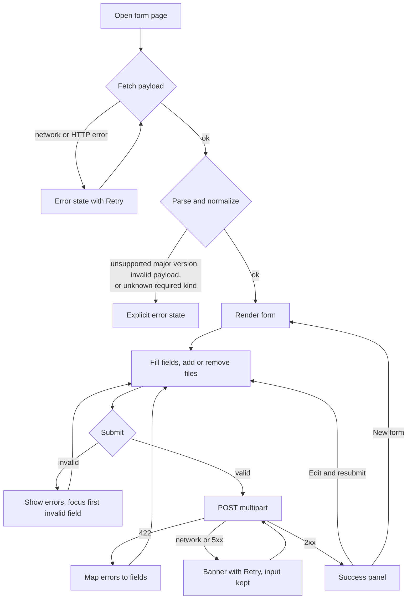

# Product Requirements Document (PRD): Dynamic Form Renderer

| | |
| --- | --- |
| Status | Approved |
| Version | 0.7 |
| Date | 2026-11-13 |
| Owner | Dariush Hadipour |
| Inputs | The challenge brief in [../README.md](../README.md) and its sample response |
| Structure based on | ISO/IEC/IEEE 29148 requirement statements (unique ID, "shall", verifiable); ISO/IEC 25010 quality model for non-functional requirements |
| Companion documents | [README.md](README.md) (document map) |

---

## 0. About this document

### 0.1 Version history

| Version | Date | Change |
| --- | --- | --- |
| 0.1 | 2026-11-13 | First draft; approved. |
| 0.2 | 2026-11-13 | Number fields accept decimals and negative values; new optional `integer` rule (`not_an_integer`); FR-15, section 5, EC-06 and AC-23 updated. |
| 0.3 | 2026-11-13 | NFR-10: the Node floor is 22.22.2, not 22.12. The test tooling (jsdom 31, undici 8) needs it; found by running the suite on 22.12. |
| 0.4 | 2026-11-13 | NFR-10: the project tracks the newest tooling: Node 26.13.1 or later (`.nvmrc`), pnpm 12.18, and the latest release of every dependency, instead of an older floor. |
| 0.5 | 2026-11-13 | Edge cases EC-18 to EC-22, from an independent review of the code and from browser tests at phone and desktop widths. |
| 0.6 | 2026-11-13 | FR-21: the message catalog is replaceable (ADR-0015); the renderer ships Persian and English. |
| 0.7 | 2026-11-13 | TR-11 and TR-12: a minimal public API in two entries (ADR-0017), and a package that works in a server-component framework. |

### 0.2 How to read it

- Requirement IDs are stable and never reused: `FR-` functional, `NFR-` non-functional, `TR-` technical constraint, `EC-` edge case, `AC-` acceptance criterion, `A-` assumption.
- Priorities use MoSCoW: **M**ust, **S**hould, **C**ould, **W**on't (this release). Cutting scope means dropping from the bottom: Could, then Should.
- Test documents link back to these IDs through the traceability matrix.

---

## 1. Overview

### 1.1 Problem

A backend team wants to change a form (fields, labels, options, validation rules) without shipping a new frontend. The frontend must therefore **render whatever form the server describes**, validate it with the server's rules, collect text values and files, and send everything back. The backend is still being built, so the frontend must be developed and tested against a realistic mock.

### 1.2 Product

A generic, reusable **Dynamic Form Renderer** for React. It is not a car-listing form: the car form in the brief is only one example payload. A second, deliberately small **Playground** view lets a reader paste or pick a payload and see the renderer react to it.

### 1.3 Goals

| ID | Goal |
| --- | --- |
| G-1 | Render any valid payload of the supported field kinds without changing renderer code. |
| G-2 | Enforce the server's validation rules in the browser and show clear, accessible, Persian error messages. |
| G-3 | Submit values and files in one request and handle every outcome (success, field errors, network failure). |
| G-4 | Make adding a new field kind a local change (one module plus one registry entry). |
| G-5 | Be easy to read, test and extend; every significant decision is documented. |

### 1.4 Non-goals

| ID | Non-goal |
| --- | --- |
| NG-1 | A visual form builder (drag and drop, saving templates, user accounts). |
| NG-2 | Persistence, authentication, analytics, server implementation. |
| NG-3 | Conditional or nested fields, cross-field validation, remote (dynamic) select options. |
| NG-4 | Field kinds beyond the five in section 5 (for example checkbox, radio, date). |
| NG-5 | Direct-to-storage uploads with presigned URLs (recorded as a considered alternative). |
| NG-6 | Shipping locales other than Persian (the structure supports them; only `fa` ships). |

### 1.5 Users

| User | Needs |
| --- | --- |
| Form filler | A form that is clear, accessible, works with a keyboard and Persian digits, and never loses their input on an error. |
| Backend developer | A documented payload and error contract, and a mock that behaves like the real API. |
| Maintainer | Clear module boundaries, tests that protect behavior, and a documented way to add a field kind. |

---

## 2. Glossary

| Term | Meaning |
| --- | --- |
| Payload | The JSON the server returns for `GET /api/forms/{formId}`. |
| Legacy payload | The shape shown in the challenge brief (`type: "input"`, `props`, `style`, string numbers, `maxSize: "5MB"`). |
| v2 payload | The explicit contract defined in [api-contract.md](api-contract.md) (`schemaVersion: 2`, `kind`, a `rules` object). |
| Canonical model | The single internal representation both payload versions are converted into. The renderer sees only this. |
| Normalizer | The pure function that converts a payload into the canonical model. |
| Field kind | One of `text`, `number`, `textarea`, `select`, `file`. |
| Rule | A validation constraint attached to a field (for example `required`, `maxBytes`). |
| Message code | A stable error identifier (for example `file_too_large`) that the client turns into Persian text. |
| Registry | The map from field kind to its module (schema builder, default value, component). |
| Preset | A ready-made payload offered by the Playground. |

---

## 3. Scope (MoSCoW)

| Priority | Items |
| --- | --- |
| Must | Fetch and render the five kinds; boundary parsing with legacy and v2 support; validation from server rules; file handling with preview and remove; single multipart submit; success, error, loading and retry states; Persian RTL with logical-only CSS; WCAG 2.2 AA for the form; mock API available in dev, tests and production preview. |
| Should | Playground view; disabled and read-only fields; field descriptions and default values; `pattern` rule; deduplicating re-selected files; CI running the full check. |
| Could (in this order, only if time remains) | Upload progress indicator; conditional visibility (`visibleWhen`). |
| Won't | Everything in section 1.4. |

---

## 4. User flow

---

## 5. Field kinds

| Kind | Control | Value | Rules that apply | Legacy mapping |
| --- | --- | --- | --- | --- |
| `text` | single-line text | string | `required`, `minLength`, `maxLength`, `pattern` | `type: "input"` with `props.type: "text"` (or no type) |
| `number` | text input with numeric keyboard (`inputMode`) | numeric string (optional minus sign, digits, optional decimal part), ASCII digits after normalization | `required`, `min`, `max`, `integer` | `type: "input"` with `props.type: "number"` |
| `textarea` | multi-line text | string | `required`, `minLength`, `maxLength`, `pattern` | `type: "textarea"` |
| `select` | single choice | one of `options[].value` | `required` | `type: "select"` |
| `file` | file picker, list of selected files | list of files | `required`, `accept`, `maxBytes`, `maxFiles` | `type: "file"` |

Common properties for every kind: `name` (unique, stable), `label`, optional `description`, optional `placeholder`, optional default value, optional `disabled` and `readOnly`.

### 5.1 Rule vocabulary

| Rule | Applies to | Meaning | Message code |
| --- | --- | --- | --- |
| `required` | all | Non-empty value; for `file`, at least one file. | `required` |
| `minLength` / `maxLength` | text, textarea | Character count bounds. | `too_short` / `too_long` |
| `pattern` | text, textarea | Value matches a regular expression. | `pattern_mismatch` |
| `min` / `max` | number | Numeric bounds. | `too_small` / `too_big` |
| `integer` | number | Value must be a whole number. Absent means decimals are allowed. | `not_an_integer` |
| `accept` | file | Allowed types: MIME type, wildcard such as `image/*`, or extension such as `.pdf`. | `file_type` |
| `maxBytes` | file | Maximum size of each file in bytes. | `file_too_large` |
| `maxFiles` | file | Maximum number of files (multiple selection only). | `too_many_files` |
| option membership | select | Value is one of the listed options. | `not_an_option` |

Client-side checks are advisory. The server validates again and its answer wins.

---

## 6. Functional requirements

### 6.1 Loading and parsing

| ID | Requirement | Pri |
| --- | --- | --- |
| FR-01 | The system shall fetch the payload from `GET /api/forms/{formId}`. | M |
| FR-02 | While the payload loads, the system shall show a loading state. On failure it shall show an error state with a Retry action and shall never leave a blank page. | M |
| FR-03 | The system shall convert every payload into the canonical model at a single boundary; no other module shall read raw payload fields. | M |
| FR-04 | The system shall accept both the legacy payload and the v2 payload. | M |
| FR-05 | A payload without `schemaVersion` shall be treated as legacy. A payload with an unsupported higher major version shall produce an explicit "client is outdated" state instead of a wrong render. | M |
| FR-06 | An unknown field kind shall be skipped with a development warning when the field is optional. When the unknown field is required, the form shall not render and the error state shall name the field. | M |
| FR-07 | A payload that is not valid JSON or fails structural validation shall produce an error state that names the problem. It shall not crash the app. | M |
| FR-08 | Duplicate field names in one payload shall be rejected with an error state. | M |

### 6.2 Rendering

| ID | Requirement | Pri |
| --- | --- | --- |
| FR-09 | The system shall render fields in payload order using the five kinds in section 5. | M |
| FR-10 | Every field shall have a programmatically associated visible label. | M |
| FR-11 | The system shall support `description` (hint text), `placeholder` and a default value. | S |
| FR-12 | The system shall support `disabled` and `readOnly`. | S |
| FR-13 | Select options shall come from the payload as a static list of `{value, label}`. | M |
| FR-14 | Server-supplied presentation data (raw CSS, hex colors, margins) shall not be applied. A `size` hint shall map to a design token (`small`, `medium`, `large`); unknown values shall be ignored. | M |
| FR-15 | Number fields shall accept Persian and Arabic-Indic digits, the Arabic decimal separator and the minus sign, and normalize them to ASCII before validation and submission. A value that is not a finite number shall be rejected with `not_a_number`. | M |
| FR-16 | Legacy labels with a trailing colon shall be displayed without it. | S |

### 6.3 Validation

| ID | Requirement | Pri |
| --- | --- | --- |
| FR-17 | Validation rules shall come from the payload as data and be applied by pure functions that do not depend on any visual component. | M |
| FR-18 | The system shall validate after the first blur of a field and on submit; after a field shows an error it shall re-validate on every change. | M |
| FR-19 | On an invalid submit the system shall send no request, show all errors and move focus to the first invalid field. | M |
| FR-20 | Each error shall be shown next to its field, linked to the control through `aria-describedby`, and the control shall expose `aria-invalid`. | M |
| FR-21 | Error text shall be produced from message codes by a message catalog, with parameters (for example the allowed size). Persian is the default; a host can supply another language (ADR-0015). | M |
| FR-22 | `pattern` shall be supported for text and textarea. | S |

### 6.4 Files

| ID | Requirement | Pri |
| --- | --- | --- |
| FR-23 | A file field shall support multiple selection when the payload allows it. | M |
| FR-24 | Each selected file shall be listed with its name and human-readable size; images shall show a thumbnail. | M |
| FR-25 | The user shall be able to remove any single file. | M |
| FR-26 | Each file shall be checked against `accept`, `maxBytes` and (for the set) `maxFiles`, and the message shall say which file failed and why. | M |
| FR-27 | Selecting files again shall add to the list; a file with the same name, size and last-modified time shall not be added twice. | S |
| FR-28 | `MB` in a size shall mean 1024 x 1024 bytes. The v2 contract shall state sizes in bytes. | M |
| FR-29 | Object URLs created for thumbnails shall be revoked when a file is removed or the field unmounts. | M |

### 6.5 Submission

| ID | Requirement | Pri |
| --- | --- | --- |
| FR-30 | The system shall send one `multipart/form-data` request to `POST /api/forms/{formId}/submissions` with every field value; each file shall be appended under its field name, repeated for multiple files. The client shall not set the `Content-Type` header manually. | M |
| FR-31 | While a submission is in flight the submit control shall be disabled and a busy state announced; a second submission shall not start. | M |
| FR-32 | On success the system shall show a success panel with two actions: "Edit and resubmit" (values and files are kept) and "New form" (everything is reset). | M |
| FR-33 | On `422` the system shall map each error to its field. An error for an unknown field name or a form-level error shall appear in a form-level alert. Entered data shall be kept. | M |
| FR-34 | On a network failure or `5xx` the system shall show a form-level alert with a Retry action and keep all entered data. | M |

### 6.6 Playground

| ID | Requirement | Pri |
| --- | --- | --- |
| FR-35 | A separate view shall let the user choose a preset payload (the original brief sample, a v2 payload, a payload with an unknown optional kind, a payload with an unknown required kind, a server-error scenario) or paste any JSON. | S |
| FR-36 | The Playground shall render a live preview with the same renderer and show parse diagnostics; invalid JSON shall produce diagnostics, never a crash. | S |
| FR-37 | The Playground shall contain no rendering or validation logic of its own. | S |

### 6.7 Internationalization

| ID | Requirement | Pri |
| --- | --- | --- |
| FR-38 | The page shall default to `lang="fa"` and `dir="rtl"`. All user-visible strings shall come from the message catalog, not from JSX. | M |
| FR-39 | The form shall render correctly when the direction is switched to `ltr`. | M |

---

## 7. Non-functional requirements (ISO/IEC 25010)

| ID | Characteristic | Requirement | Pri |
| --- | --- | --- | --- |
| NFR-01 | Usability, accessibility | The form shall conform to WCAG 2.2 level AA: real labels, programmatic error association, full keyboard operation, visible focus, sufficient contrast, status and error messages announced to assistive technology. The automated accessibility test shall report no violations. | M |
| NFR-02 | Usability, internationalization | Styles shall use CSS logical properties and values only (for example `margin-inline-start`, never `margin-right`; four-value physical shorthands are banned). A style check shall enforce this. Adding a locale shall require adding one catalog file. | M |
| NFR-03 | Maintainability, modularity | The code shall be layered: schema contracts, engine, field modules and registry, UI primitives, API client, mocks, app composition. The engine shall not import styles or call the network; UI components shall not parse payloads. | M |
| NFR-04 | Maintainability, extensibility | Adding a field kind shall require one new module and one registry entry, with no change to the form renderer. This shall be demonstrated in the documentation. | M |
| NFR-05 | Maintainability, type safety | Strict TypeScript (including `noUncheckedIndexedAccess` and `exactOptionalPropertyTypes`), no `any`, no `@ts-ignore` without a written reason. | M |
| NFR-06 | Testability | Parsing, normalization, rule evaluation and the file module shall be unit-testable without a DOM. Critical behavior shall be covered by component and integration tests. | M |
| NFR-07 | Reliability, fault tolerance | No failure of the network, the payload or the mock shall result in a blank page. An error boundary shall wrap the app, and a failed mock start shall show a visible message. | M |
| NFR-08 | Security | Client checks are advisory; no user content is rendered as HTML; file contents are read only to create previews; no secrets or credentials exist in the repository. | M |
| NFR-09 | Performance efficiency | Target: application JavaScript at most 150 kB gzip excluding the lazily loaded mock chunk. Typing in one field shall not re-render other fields. | S |
| NFR-10 | Portability, compatibility | Runs with Node 26.13.1 or later using npm or pnpm; supports current Chrome, Firefox and Safari; the mock API works in `build` plus `preview`. | M |
| NFR-11 | Maintainability, analyzability | Code comments explain why a decision was made, not what the code does. Each significant decision has an ADR. The README states how to install, run, test and extend. | M |
| NFR-12 | Maintainability, process | Small commits with Conventional Commits messages; tests in the same commit as the feature; a single `check` command (type-check, lint, style lint, format, tests) that CI also runs. | M |

---

## 8. Technical requirements

| ID | Requirement |
| --- | --- |
| TR-01 | React 19, TypeScript 7 in strict mode, Vite 8. |
| TR-02 | Form state: react-hook-form. Validation: zod, used both to parse the payload at the boundary and to build the values schema from the rules. |
| TR-03 | Server state (fetch form, submit): TanStack Query. |
| TR-04 | Mocking: MSW 3 handlers shared by the browser (development and production preview) and by tests; an environment flag turns mocking off. The application code uses the same `fetch` path with and without mocks. |
| TR-05 | Styling: CSS Modules and CSS-variable design tokens, with a thin `ui/` primitive layer. A lint rule shall stop the engine importing stylesheets. |
| TR-06 | Tests: Vitest, Testing Library, user-event, an axe-based accessibility check. Multipart tests need a documented test-environment shim. |
| TR-07 | Quality gates: oxlint (type-aware), a CSS logical-properties linter, Prettier, and a GitHub Actions workflow that runs the full check. |
| TR-08 | Scripts shall not depend on a specific package manager; pnpm is the primary one and npm shall also work. |
| TR-09 | Git hooks (husky, lint-staged) shall not fail an install when `.git` is missing. |
| TR-10 | Documentation lives in `docs/`; `ai.md` at the repository root is authored solely by the developer. |
| TR-11 | The package exports only what is needed: two public entries (client and logic), the list pinned by a test, and no module whose export nothing uses (ADR-0017). |
| TR-12 | The packed package type-checks for a strict consumer under `bundler` and `nodenext`, marks its client entry `"use client"`, and its logic entry imports no React. |

---

## 9. API behavior summary

The full contract, with examples, is in [api-contract.md](api-contract.md). This section states only what the product depends on.

| Interaction | Behavior |
| --- | --- |
| `GET /api/forms/{formId}` | `200` with a legacy or v2 payload. Any other status is an error state. |
| `POST /api/forms/{formId}/submissions` | Request is `multipart/form-data`. `2xx` is success. `422` carries per-field errors as `{code, params?, message?}` and optional form-level errors. Other failures are treated as network or server errors. |
| Versioning | No `schemaVersion` means legacy. A higher unsupported major version means "client is outdated". Unknown optional fields and rule keys are ignored. |
| Error text | The client owns Persian wording; a server `message` is only a fallback. |

---

## 10. Edge cases

| ID | Case | Expected behavior |
| --- | --- | --- |
| EC-01 | Payload has zero fields. | Render an empty-state message; submit is disabled. |
| EC-02 | Select with no options. | Field renders disabled with a clear message; if required, the form reports it cannot be submitted. |
| EC-03 | Legacy `min`/`max` are strings (`"1900"`). | Normalizer converts them to numbers; non-numeric values make the payload invalid (FR-07). |
| EC-04 | Legacy `maxSize` is `"5MB"`, `"500KB"`, or malformed. | Parsed to bytes (1024-based); malformed value invalidates that field's size rule and logs a development warning. |
| EC-05 | Legacy `multiple` is absent. | Single file. |
| EC-06 | User types Persian or Arabic-Indic digits, a decimal part, or a minus sign. | Normalized to ASCII and accepted; letters and malformed numbers (`1.2.3`, `--5`) are rejected with `not_a_number`; a decimal is rejected with `not_an_integer` only when the field has the `integer` rule. |
| EC-07 | Same file chosen twice. | Not added twice (FR-27). |
| EC-08 | File has no MIME type or no extension. | Checked against `accept` by whatever is known; if neither can match, it is rejected with `file_type`. |
| EC-09 | A file is removed, then the same file is added again. | It is accepted as a new selection. |
| EC-10 | Submit pressed twice quickly. | Only one request is sent (FR-31). |
| EC-11 | `422` names a field that does not exist. | Shown in the form-level alert (FR-33). |
| EC-12 | `GET` returns HTML or a non-JSON body. | Error state (FR-07). |
| EC-13 | Server sends an unknown rule key. | Ignored. |
| EC-14 | Legacy `props.type` is something other than `text` or `number` (for example `email`). | Treated as `text` with a development warning. |
| EC-15 | Very long label or option text. | Wraps; layout does not break in either direction. |
| EC-16 | Payload changes between loads (different fields). | Previous values are not carried over to unrelated fields. |
| EC-17 | Mock service worker cannot start. | Visible message with the reason (NFR-07). |
| EC-18 | A field name that the form cannot store: it has a quote, or is `constructor`, `prototype` or `__proto__`. | The payload is rejected as invalid (FR-07), like a name with a dot. |
| EC-19 | `accept` is `*/*` (or `*`). | Every file is accepted. |
| EC-20 | The browser reports "offline" or the server never answers. | The request is still attempted and has a time limit; a failure shows the error state or the Retry banner, never a spinner or busy button for ever (FR-02, FR-34). |
| EC-21 | A `422` field with an empty list of errors, or an error code with no `params` that its text needs. | The empty list is ignored; the text falls back to the server message or the generic one, never raw placeholders (FR-33). |
| EC-22 | A disabled or read-only file field; a long file name on a phone. | The label cannot open the file dialog and no event changes the files; the name wraps and the row never squeezes it to one character (FR-12, EC-15). |

---

## 11. Acceptance criteria

| ID | Given / When / Then | Covers |
| --- | --- | --- |
| AC-01 | Given the legacy sample payload, when the page loads, then five kinds render in order with their labels and no trailing colon. | FR-01, FR-04, FR-09, FR-10, FR-16 |
| AC-02 | Given a v2 payload, when the page loads, then the same renderer shows its fields with their rules applied. | FR-04, FR-17 |
| AC-03 | Given a payload with a higher unsupported major version, then an explicit outdated-client message is shown and no form renders. | FR-05 |
| AC-04 | Given an unknown optional kind, then the other fields render and a development warning is logged; given an unknown required kind, then an error naming the field is shown. | FR-06 |
| AC-05 | Given a failing `GET`, then an error state with Retry appears; when Retry succeeds, the form renders. | FR-02 |
| AC-06 | Given a required text field, when the user focuses and leaves it empty, then a Persian required error appears, linked by `aria-describedby`, with `aria-invalid="true"`. | FR-18, FR-20, FR-21 |
| AC-07 | Given a number field with `min 1900`, when the user types `۱۸۰۰`, then it is read as 1800 and rejected as too small; typing `۲۰۲۰` clears the error. | FR-15, FR-18 |
| AC-08 | Given a file field with `accept image/*`, when the user adds a PDF, then the file is rejected with a message naming the file and the reason. | FR-26 |
| AC-09 | Given `maxBytes` of 5 MB, when a larger file is added, then it is rejected with the allowed size in the message. | FR-26, FR-28 |
| AC-10 | Given selected images, then each shows name, size and a thumbnail, and each can be removed individually; removing revokes its object URL. | FR-24, FR-25, FR-29 |
| AC-11 | Given an invalid form, when the user submits, then no request is sent and focus moves to the first invalid field. | FR-19 |
| AC-12 | Given a valid form with two files, when the user submits, then exactly one multipart request is sent with every field and both files under one field name and no manual `Content-Type`. | FR-30 |
| AC-13 | Given a submission in flight, then the submit control is disabled and a second submission does not start. | FR-31 |
| AC-14 | Given a `2xx` response, then a success panel appears; "Edit and resubmit" restores the form with values and files; "New form" shows an empty form. | FR-32 |
| AC-15 | Given a `422` with a field error, then the message appears under that field and entered data is intact; an unknown field name appears in the form-level alert. | FR-33 |
| AC-16 | Given a network failure during submit, then a form-level alert with Retry appears and entered data is kept. | FR-34 |
| AC-17 | Given the Playground, when a preset is chosen or JSON is pasted, then the preview updates; invalid JSON shows diagnostics and does not crash. | FR-35, FR-36 |
| AC-18 | Given the default page, then `lang="fa"` and `dir="rtl"`; given `dir="ltr"`, then the form renders without broken layout. | FR-38, FR-39 |
| AC-19 | Given the rendered form, then the automated accessibility test reports no violations, and the full form is operable with the keyboard only. | NFR-01 |
| AC-20 | Given a stylesheet with a physical property such as `margin-right`, then the style check fails. | NFR-02 |
| AC-21 | Given a new field kind module and its registry entry, then it renders and validates with no change to the form renderer. | NFR-04 |
| AC-22 | Given `build` plus `preview`, then the form loads through the mock API. | NFR-10, TR-04 |
| AC-23 | Given a number field without `integer`, then `12.5` and `-3` are accepted; given `integer`, then `12.5` is rejected with a Persian message for `not_an_integer`; given any number field, then `abc` is rejected with `not_a_number`. | FR-15 |

---

## 12. Assumptions and open items

These are my working assumptions. Each one is listed so it can be challenged before it is frozen in an ADR.

| ID | Assumption | If wrong |
| --- | --- | --- |
| A-1 | The server does not send presentation data; styling belongs to the design system (FR-14). | Allow a small, explicit set of presentation hints. |
| A-2 | `MB` means 1024 x 1024 bytes (FR-28). | Change one constant and its tests. |
| A-3 | A single multipart request is acceptable for the expected file sizes (FR-30). | Add the presigned-URL flow behind the same API boundary. |
| A-4 | Cross-field validation is not needed for this form (NG-3). | Add a `rules.crossField` extension in a later version. |
| A-5 | The Playground is a view inside the same app, with no router (FR-35). | Introduce a router only if more views appear. |
| A-6 | Documents stay flat in `docs/` (eight files plus an index). | Group into folders if the set grows. |
| A-7 | The real backend's final contract may differ; the adapter boundary (FR-03) is where that is absorbed. | Adjust the normalizer and the contract document only. |
