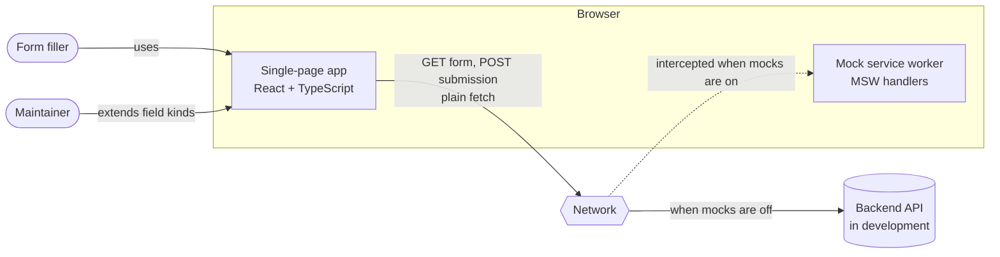
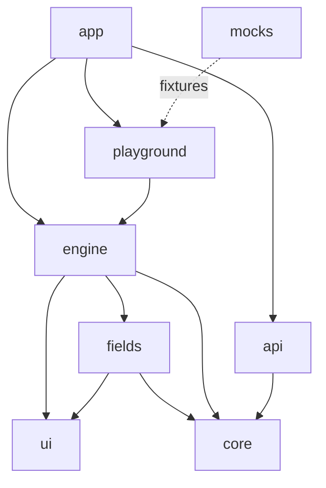
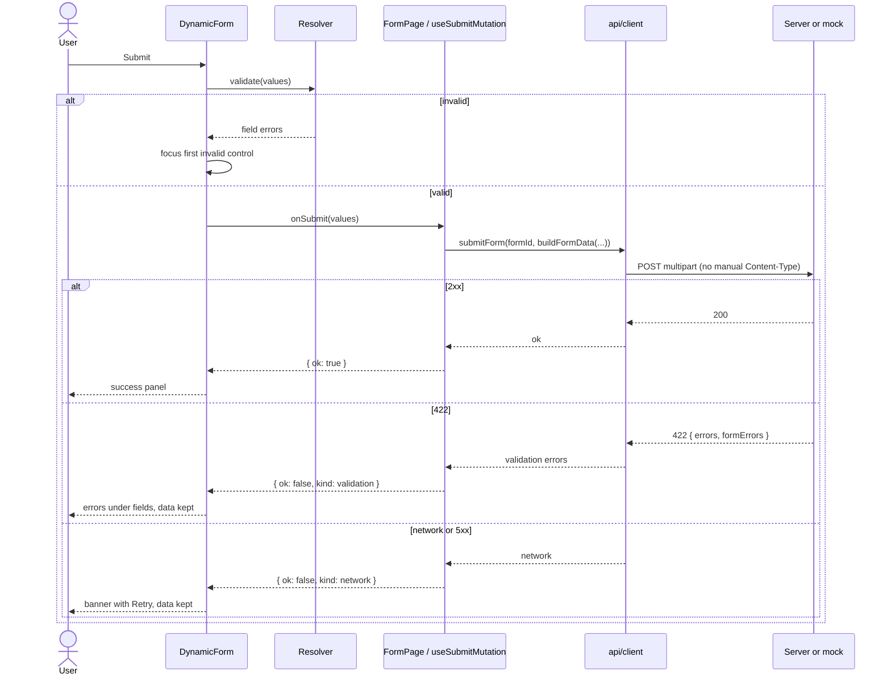
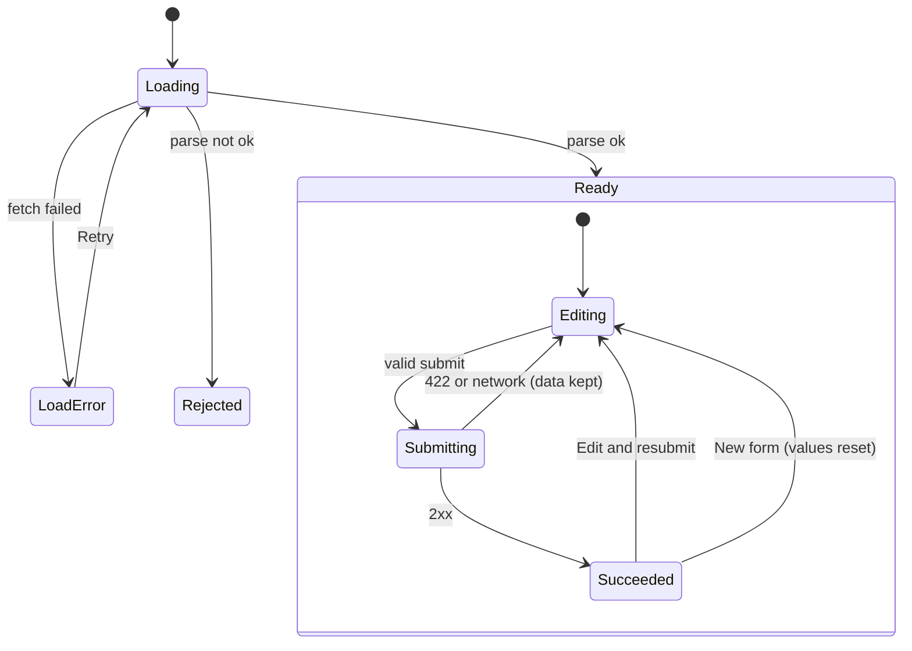

# Technical Design Document (TDD): Dynamic Form Renderer

| | |
| --- | --- |
| Status | Approved |
| Version | 0.1 |
| Date | 2026-11-13 |
| Owner | Dariush Hadipour |
| Inputs | [prd.md](prd.md) v0.6 |
| Structure based on | IEEE 1016 design viewpoints (context, composition, information, interface, interaction, state dynamics, algorithm); C4 model for the diagrams; decisions recorded as ADRs |
| Companion documents | [README.md](README.md), `adr/` (decision records, written next), `api-contract.md` (written after this document) |

---

## 0. Version history

| Version | Date | Change |
| --- | --- | --- |
| 0.1 | 2026-11-13 | First draft. |

---

## 1. Purpose and scope

This document says **how** the requirements in the PRD are built: modules, their boundaries, the data model, the main algorithms and the flows between them. It does not repeat the requirements. Each design choice that was a real decision points to an ADR (section 15); the ADRs hold the options considered and the reasons.

Out of scope here: the wire format examples (see `api-contract.md`), test cases (see the test documents), the order of work (see `implementation-plan.md`).

---

## 2. Context viewpoint



- The app always calls the API with plain `fetch`. Whether the answer comes from the mock service worker or from a real backend is invisible to the application code (TR-04).
- The real backend's final contract may differ; the adapter boundary in section 4 is the only place that has to change (PRD A-7).

---

## 3. Design principles

1. **One boundary.** Raw payloads are parsed once, into a canonical model. Nothing else reads wire fields (FR-03).
2. **Data, not code.** Validation rules and field descriptions are data; the same pure functions apply them in the browser, in tests and in the Playground (FR-17).
3. **A field kind is a unit.** Everything about a kind lives in its own folder; the renderer only looks kinds up (NFR-04).
4. **Dependencies point one way.** Pure core, then field kinds, then engine, then app (section 4). Lint enforces the important edges.
5. **Styling is not logic.** The engine never imports styles; components render through the UI kit contract (`ui-kit/`), whose default implementation is `default-kit/` (NFR-02, NFR-03).
6. **Fail visibly.** Every failure ends in a message and a next action, never a blank page (NFR-07).
7. **Smallest thing that works.** No abstraction without a second user; no library without a stated reason (ADRs).

---

## 4. Composition viewpoint

### 4.1 Source layout

The repository is a pnpm workspace (ADR-0014): the renderer is a package, and the demo app is built on it. Inside each `src/`, the conventions of ADR-0016 apply: every name is kebab-case, **a module is a folder** with its code in `index.ts` or `index.tsx`, each file has exactly one export (`export { X };` at the bottom, types in their own modules), and a module's stylesheet and test sit beside it as `styles.module.css` and `index.test.ts(x)`. A source file that exported several things became a folder holding one module per thing: for example `core/model/` holds `form-model/`, `field-model/`, `text-field/` and so on. Names below are folders; the paths in the rest of this document name the same modules by their old file names.

```
packages/renderer/           the library (@dynamic-form/renderer): no network code, no knowledge of the app
  src/
    index.ts                  the public API; the package `exports` make nothing else reachable
    core/                     pure TypeScript, no React, no DOM (55 modules)
      model/  issues/  kind/  canonical types, issues and rejections, the KindDefinition contract
      normalize/  legacy/  v2/  wire/    createNormalizer: envelope, version gate, dispatch to kinds; what every legacy / v2 field has in common; small helpers
      accept/  pattern/  sizes/  digits/  file-list/  message-codes/    pure rule helpers
      field-errors/  server-errors/  form-data/    codes and params, the 422 body, the multipart body
    fields/                   one folder per kind, and what the kinds share (25 modules)
      text/ number/ textarea/ select/ file/   each: definition/ (pure) and component/ (React), with their tests
      definitions/            FIELD_DEFINITIONS, the one list that is the registry, and `normalize` built from it
      field-kinds/            FIELD_KINDS: the registry with the components
      define-field-kind/  field-frame/  component/  string-field/    pairing a definition with a component; label, hint, error and ARIA wiring; the props contract; what text and textarea share
    engine/                   React: dynamic-form/, field-renderer/, resolver/, build-values-schema/, success-panel/, outcome/
    ui-kit/                   the contract with a design system: ui-kit/ (UiKit), props/ (one type per component), field-ids/, described-by/
    default-kit/              the default design system: one folder per component, tokens.css, the shared control styles
    provider/                 dynamic-form-provider/, use-ui-kit/, use-messages/ and the two contexts
    i18n/                     messages/, translator/, create-translator/, fa-messages/, en-messages/, direction/
    test/                     setup.ts (jest-dom, axe), render-field/, test-ui-kit/, fixtures/, t/
  vite.config.ts  tsconfig.build.json   the library build: one ES module, styles, tokens, declarations
apps/demo/                    the app built on the library, through its public API only
  index.html  public/ (mock worker)
  src/
    main.tsx  base.css        entry: starts the mock (if enabled), mounts the app; page-level defaults
    app/                      composition only: app/ (nav and view switch), providers/, error-boundary/, route/, form-page/
    chrome/                   page, nav, section, spinner, and the rejection and warning alerts (page-level, not part of the form)
    messages/                 the demo's own text and its translator
    api/                      client/ (the only place that calls fetch), queries/ (TanStack Query hooks), base-url/
    mocks/                    handlers/, fixtures/, browser/, start/ (with failure reporting)
    playground/               presets/, diagnostics/ (reading the editor text), dry-run/, playground-view/
    test/                     setup.ts, the undici shim, the Node mock server, t/
scripts/                      check-dist.mjs (bundle budget, mock in its own chunk), pack-smoke.mjs (pack, install, render)
tests/tooling/                tests of the repository's own rules (lint boundaries, styles, CI, Node range, source conventions)
docs/   .github/workflows/    (repository root)
```

### 4.2 Dependency rules

| Module | May import | Must not import | Enforced by |
| --- | --- | --- | --- |
| `core/` | itself, `zod` | `react`, `fields/`, `engine/`, `ui/`, `api/`, DOM globals other than the `File` and `FormData` types | lint (restricted imports) |
| `fields/<kind>/definition.ts` | `core/` | `react`, `default-kit/`, `ui-kit/`, `provider/`, `engine/` | lint |
| `fields/<kind>/Component.tsx` | `ui-kit/`, `provider/`, own definition | `default-kit/`, `api/`, `mocks/`, style files | lint |
| `engine/` | `core/`, `fields/`, `ui-kit/`, `provider/` | `default-kit/`, `api/`, `mocks/`, any `.css` file | lint |
| `ui-kit/` | `react` types | everything else in the library | lint |
| `default-kit/` | `react`, `ui-kit/`, own CSS | `core/`, `fields/`, `engine/`, `provider/`, `api/` | lint |
| `provider/` | `default-kit/`, `i18n/`, `ui-kit/` | `engine/`, `fields/` | convention |
| `apps/demo` (everything) | the renderer's public entry and `tokens.css` | any deeper path of `@dynamic-form/renderer` | lint, and the package `exports` |
| `api/` | the public entry's core functions, `@tanstack/react-query` | the public entry's components | lint |
| `app/` | everything above | `mocks/` except through `main.tsx`'s dynamic import | convention, reviewed |
| `playground/` | the public entry, `mocks/fixtures` | `api/` | lint |

### 4.3 Dependency graph



---

## 5. Information viewpoint

### 5.1 Canonical model

```ts
type FormModel = {
  formId: string;
  schemaVersion: 1 | 2;            // 1 = legacy
  title?: string;
  fields: readonly FieldModel[];
};

type FieldBase = {
  name: string;                    // unique, stable; also the multipart key
  label: string;                   // display text, trailing colon already removed
  description?: string;
  placeholder?: string;
  required: boolean;               // false for legacy payloads unless they say otherwise
  disabled?: boolean;
  readOnly?: boolean;
  size?: 'small' | 'medium' | 'large';   // token name only, never CSS
};

type StringRules   = { minLength?: number; maxLength?: number; pattern?: string };
type TextField     = FieldBase & { kind: 'text'; defaultValue?: string; rules: StringRules };
type TextareaField = FieldBase & { kind: 'textarea'; defaultValue?: string; rules: StringRules };
type NumberField   = FieldBase & { kind: 'number'; defaultValue?: string; rules: { min?: number; max?: number; integer?: boolean } };
type SelectField   = FieldBase & { kind: 'select'; defaultValue?: string; options: readonly { value: string; label: string }[] };
type FileField     = FieldBase & { kind: 'file'; multiple: boolean; rules: { accept?: readonly string[]; maxBytes?: number; maxFiles?: number } };

type FieldModel = TextField | TextareaField | NumberField | SelectField | FileField;
type FieldValue = string | File[];
type FormValues = Record<string, FieldValue>;
```

`FieldModel` is a discriminated union, so `switch (field.kind)` is exhaustive wherever it is used. Adding a kind adds a member to the union; the compiler then points at every place that must handle it.

### 5.2 Parse result

```ts
type Issue = { path: string; code: string; message: string };        // developer-facing, English
type ParseResult =
  | { ok: true; model: FormModel; warnings: Issue[] }                 // warnings: skipped optional fields, ignored keys
  | { ok: false; reason: 'invalid' | 'outdated' | 'unknown-required-kind' | 'duplicate-name'; issues: Issue[] };
```

### 5.3 Error information

```ts
type FieldError = { code: string; params?: Record<string, string | number> };   // code is a stable message code
type ServerErrors = { fields: Record<string, FieldError[]>; form: FieldError[] };
```

Persian text is produced only at display time from `FieldError` by `t(code, params)` (FR-21).

---

## 6. Interface viewpoint

### 6.1 Kind definition (pure) and kind (with component)

```ts
interface KindDefinition<F extends FieldModel = FieldModel> {
  readonly kind: F['kind'];
  fromLegacy?(raw: Raw, path: string): LegacyParse<F>;  // 'not-mine' | { ok: true, field, warnings } | { ok: false, issues }
  fromV2(raw: Raw, path: string): FieldParse<F>;        // { ok: true, field, warnings } | { ok: false, issues }
  valueSchema(field: F): z.ZodType<FieldValue>;          // validation; issues carry message codes and params
  defaultValue(field: F): FieldValue;
  appendTo(field: F, value: FieldValue, body: FormData): void;   // submission encoding
}

// A definition is written against its own field type; defineKind widens it to KindDefinition once
// (and throws if it is ever handed a field of another kind), so the registry holds one type.
declare function defineKind<F extends FieldModel>(definition: KindDefinition<F>): KindDefinition;

interface FieldKind<F extends FieldModel = FieldModel> {
  readonly definition: KindDefinition<F>;
  readonly Component: ComponentType<FieldComponentProps<F>>;
}

interface FieldComponentProps<F> {
  field: F;
  id: string;                      // unique per form instance
  value: FieldValue;
  onChange(next: FieldValue): void;
  onBlur(): void;
  errors: readonly FieldError[];   // coded errors; the component shows their Persian text
  inputRef: (element: HTMLElement | null) => void;   // so the engine can focus the first invalid control
}
```

Components never see react-hook-form, the network or the payload; they are testable on their own.

### 6.2 Registry

`fields/definitions.ts` exports `FIELD_DEFINITIONS` (pure) and `fields/index.ts` exports `FIELD_KINDS: readonly FieldKind[]`, the same list with a component per kind, built with `defineFieldKind`; a test keeps the two in step. Everything that needs a kind is built from this one list: `createNormalizer(FIELD_DEFINITIONS)` and, later, the renderer's lookup map. Adding a kind means one new folder, one entry in this list and one member of the `FieldModel` union (AC-21). The normalizer is called as `normalize(raw, formId)`: the id that was requested becomes `model.formId`, because the legacy shape has none.

### 6.3 Engine

```ts
interface DynamicFormProps {
  model: FormModel;
  onSubmit(values: FormValues): Promise<SubmitOutcome>;   // injected; the engine has no network code
  kinds?: readonly FieldKind[];                            // defaults to FIELD_KINDS; tests pass their own
}
type SubmitOutcome =
  | { ok: true; summary?: ReactNode }
  | { ok: false; kind: 'validation'; errors: ServerErrors }
  | { ok: false; kind: 'network' };
```

A different `model` object is a different form: the engine keys its state on the object, so nothing typed into one form can leak into the next (EC-16). `FormPage` logs the normalizer's warnings and supplies an `onSubmit` that calls the API. The Playground supplies a dry-run `onSubmit` that shows the would-be request instead of sending it. That is why the engine can have no `api/` import.

### 6.4 API client (`api/`)

```ts
fetchForm(formId: string, signal?: AbortSignal): Promise<unknown>          // raw JSON, unparsed
submitForm(formId: string, body: FormData, signal?: AbortSignal): Promise<SubmitHttpResult>
useFormQuery(formId: string): UseQueryResult<ParseResult>                  // runs normalize inside queryFn
useSubmitMutation(formId: string, model: FormModel): UseMutationResult<SubmitOutcome, never, FormValues>
```

`submitForm` never sets `Content-Type`. HTTP statuses become values (`validation`, `network`) at this layer; the engine never sees an HTTP detail.

### 6.5 i18n

`t(code: string, params?: Record<string, string | number>): string` reads `catalog.fa.ts`. A missing key returns the code itself and logs a development warning, so a gap is visible rather than silent. Numbers and sizes are formatted with `Intl`.

---

## 7. Interaction viewpoint

### 7.1 Data flow

1. **Fetch.** `useFormQuery` calls `fetchForm`, which returns the raw JSON.
2. **Parse.** The same query function runs `normalize(raw)`; the cached value is a `ParseResult`, never raw JSON.
3. **Initialize.** `DynamicForm` builds default values from each kind's `defaultValue`.
4. **Resolve fields.** `FieldRenderer` looks up each field's kind in the registry and renders its `Component` inside a `Controller`.
5. **Validate.** A resolver built from the kinds' `valueSchema` functions validates the whole form; it returns codes and params.
6. **Edit.** Components call `onChange` and `onBlur`; only the changed field re-renders.
7. **Collect files.** The file component keeps the selected `File[]` in form state; thumbnails use object URLs revoked on removal and unmount.
8. **Encode.** On a valid submit, `buildFormData(model, values, kinds)` creates a `FormData` using each kind's `appendTo`.
9. **Submit.** `onSubmit` is called; in `FormPage` it posts through `useSubmitMutation`.
10. **Outcome.** `SubmitOutcome` drives the state machine in section 8: success panel, field errors, or a retryable banner.

### 7.2 Submit sequence



---

## 8. State dynamics viewpoint

### 8.1 Page state



`Rejected` carries the `reason` (invalid payload, outdated client, unknown required kind, duplicate name) and renders a different message for each.

### 8.2 Field state

Per field: `pristine`, `touched`, `invalid`. An error is shown only once the field was blurred or a submit was attempted; after that it re-validates on every change (FR-18). This is react-hook-form's `onTouched` mode plus `reValidateMode: 'onChange'`.

---

## 9. Algorithm viewpoint

### 9.1 Normalizer

```
normalize(raw):
  envelope = parse raw as { schemaVersion?: int, fields: unknown[] , formId?, title? }   (zod)
  if not object or fields not an array            -> not ok, 'invalid'
  version = envelope.schemaVersion ?? 1
  if version > MAX_SUPPORTED_MAJOR                -> not ok, 'outdated'
  for each raw field (in order):
     v1: ask each kind definition in order: fromLegacy(raw) -> 'not-mine' | ok | invalid
         no kind claims it                        -> unknown kind
     v2: look up raw.kind in the kind map          -> fromV2(raw), or unknown kind
     unknown kind: if the field is required (v2 rules.required, or legacy required/props.required)
                       -> not ok, 'unknown-required-kind' (names the field)
                   else -> add warning, skip
     invalid known field                          -> collect issues; whole result 'invalid'
  duplicate names                                 -> not ok, 'duplicate-name'
  return ok with model and warnings
```

Legacy payloads have no way to say "required"; the normalizer reads an optional `required` or `props.required` if present and otherwise treats the field as optional (the sample has neither). The `text` and `number` kinds both claim `type: "input"` and split on `props.type`; `fromLegacy` returns `'not-mine'` for the other one.

### 9.2 Legacy field conversion (shared helpers in `core/`)

- Labels: trim, drop one trailing `:` or `：`.
- Numbers as strings (`"1900"`) are parsed with `Number`; `NaN` makes the field invalid.
- `props.type` other than `text`/`number` becomes `text` with a warning (EC-14).
- `props.size` maps to a token name when it is `small`, `medium` or `large`; everything else (including `color` and `style`) is dropped (FR-14).
- `maxSize` goes through `parseSize`.

### 9.3 `parseSize`

`^\s*(\d+(?:\.\d+)?)\s*(B|KB|MB|GB)?\s*$`, case-insensitive; no unit means bytes; units are powers of 1024 (FR-28). Returns bytes (rounded down) or a failure. Unit tests cover decimals, spacing, case, zero and garbage.

### 9.4 Digit and number normalization

`toAsciiDigits` maps U+06F0 to U+06F9 and U+0660 to U+0669 to `0`..`9`, `٫` to `.`, and U+2212 (minus) to `-`. `parseNumber(text)` accepts `^-?\d+(\.\d+)?$` after trimming and normalizing, and returns a finite number or a failure. The stored form value remains the user's text; the normalized form is what is validated and submitted (FR-15).

### 9.5 `accept` matching

A token is a MIME type, a wildcard `type/*`, or an extension starting with `.`. A file matches when any token matches by lowercase `file.type`, or, if `file.type` is empty, by extension (EC-08). `accept` and `file.type` are browser hints; the server re-validates (section 5.1 of the PRD).

### 9.6 Values schema and the resolver

`buildValuesSchema(model, kinds)` makes a `z.object` whose entry for each field is `definition.valueSchema(field)`. Each refinement reports a **code** and optional **params** (for example `file_too_large` with the file name and the limit).

`react-hook-form`'s stock zod resolver keeps only `type` and `message` from an issue, which would lose the params. The engine therefore has a small resolver (about 25 lines) that runs `safeParseAsync` and maps each issue to `{ code, params }` stored as the field error. This is decision ADR-0003; Phase 0 re-checks that the stock resolver really cannot carry the params before the custom one is written.

### 9.7 Server-error mapping

`parseServerErrors(body)` validates the 422 body with zod and returns `ServerErrors`. For each key in `fields`: if the key is a known field name it becomes a field error, otherwise it joins `form`. `form` errors and unknown-field errors render in the form-level alert (FR-33).

### 9.8 File list maintenance

Adding files: append, skipping any whose `${name}:${size}:${lastModified}` key already exists (FR-27). After each change the engine validates the file field. The native input is reset after reading so the same file can be chosen again after removal (EC-09).

---

## 10. Cross-cutting design

### 10.1 Accessibility (NFR-01)

- Every control has a `<label for>`; description and error use `aria-describedby`; invalid controls set `aria-invalid`.
- Each field's error sits in a persistent polite live region linked by `aria-describedby` (empty when valid); form-level messages use `role="alert"` (ADR-0010).
- File field: a real `<button>` (the control a person focuses and presses) that opens a native file input kept hidden behind it (`hidden`, out of the tab order and the accessibility tree). The field label is attached to the hidden input, so clicking the label also opens the dialog; the button is named by the label plus its own text through `aria-labelledby`, so the visible words are part of the name. A button cannot carry `aria-required` or `aria-invalid`, so its description says the field is required and holds the error text. After every choice the input is cleared so the same file can be chosen again. The selected files are a real list with one remove button per item, named after the file, and a polite status line says how many are chosen; focus returns to the choose button after a removal.
- On a failed submit the engine focuses the first invalid control using the `inputRef` each component forwards; this includes the file control.
- Busy state: the submit control is `aria-disabled` while submitting and a status message announces progress.
- The success panel receives focus so the outcome is announced.

### 10.2 RTL and styling (NFR-02)

- `<html lang="fa" dir="rtl">` set in `index.html`; `i18n/direction.ts` can switch both at run time (used by the `ltr` test and the Playground).
- Tokens in `default-kit/tokens.css` as CSS variables (spacing, color, radius, type scale); components use logical properties only; a style lint and a four-value-shorthand ban enforce it.
- Number and size formatting through `Intl` with the active locale.

### 10.3 Error handling matrix

| Failure | Detected in | Result |
| --- | --- | --- |
| Network error or non-2xx on `GET` | `api/client` | Load error state with Retry |
| Body is not JSON or fails the envelope | `core/normalize` | `Rejected: invalid` |
| Unsupported major version | `core/normalize` | `Rejected: outdated` |
| Unknown required kind, duplicate name | `core/normalize` | `Rejected` with the field name |
| Invalid field values on submit | resolver | Field errors, focus first invalid |
| `422` | `api/client`, `core/server-errors` | Field and form errors, data kept |
| Network error or `5xx` on `POST` | `api/client` | Banner with Retry, data kept |
| Render exception | `app/ErrorBoundary` | Fallback screen with Reload |
| Mock worker cannot start | `mocks/start` | Visible message with the reason, then the app still mounts |

### 10.4 Performance (NFR-09)

`Controller` isolates each field, so typing re-renders one field. The mock is a dynamic import, loaded only when mocking is enabled, so it sits outside the main chunk. Thumbnails use object URLs, not data URLs, and are revoked.

### 10.5 Security (NFR-08)

React escapes all text; no `dangerouslySetInnerHTML`. File contents are never read by the app except through object URLs for previews. The `pattern` rule is compiled inside a try/catch so a malicious or broken pattern from the server cannot throw during render; a pattern that fails to compile is ignored with a warning.

---

## 11. Mocking and test seams

- `mocks/fixtures/` holds one payload per scenario: the legacy sample, a v2 form, an unknown optional kind, an unknown required kind, an outdated version, and a server-error form. The Playground presets reuse the same objects.
- `mocks/handlers.ts` serves `GET /api/forms/:formId` from the fixtures and implements `POST` with real server-side rules (so `422` is reachable), parsing the multipart body with `request.formData()`.
- Tests use the same handlers through the Node server (`src/test/server.ts`); individual tests override a handler to force a status. The per-form counters ("fails once, then works") are reset after every test.
- `mocks/start.ts` starts the worker through a dynamic import, honours `VITE_ENABLE_MOCKS=false`, and never throws: a failure comes back as a reason that `main.tsx` passes to the app.
- Seams that make tests cheap: `core/` is pure; `FieldComponentProps` lets a component be rendered without a form; `DynamicForm` takes `onSubmit`, so engine tests need no network; `createNormalizer(kinds)` takes the kind list, so a test can add a fake kind (AC-21).
- Test environment: jsdom with a documented shim so multipart bodies work (ADR-0009).

---

## 12. Build, tooling and CI

- Scripts (no package-manager-specific commands): `dev`, `build`, `preview`, `test`, `lint`, `format:check`, `check`. `check` runs the type-check, `oxlint --type-aware`, the style lint, Prettier and the tests; CI and the pre-commit hook use the same pieces.
- Pre-commit: `husky` runs `lint-staged` (oxlint, stylelint, Prettier on staged files). The `prepare` script tolerates a missing `.git`.
- CI (GitHub Actions): install, `check`, `build`, then `check:dist` (the application JavaScript is at most 150 kB gzip and the mock is a separate chunk, read from the Vite build manifest). It runs on every push.
- Environment: `VITE_ENABLE_MOCKS` (default on) controls the mock worker; the worker script is served from `public/`.

---

## 13. Requirement to module trace

| Requirements | Primary modules |
| --- | --- |
| FR-01, FR-02, FR-34 | `api/client`, `api/queries`, `app/FormPage` |
| FR-03 to FR-08, FR-16 | `core/normalize`, `core/wire`, kind `fromLegacy` / `fromV2` |
| FR-09 to FR-14 | `engine/DynamicForm`, `engine/FieldRenderer`, `fields/*`, `default-kit/*` |
| FR-15 | `core/digits`, `fields/number` |
| FR-17 to FR-22 | `core/*` helpers, kind `valueSchema`, `engine/resolver`, `i18n/*` |
| FR-23 to FR-29 | `fields/file`, `core/sizes`, `core/accept` |
| FR-30 to FR-33 | `core/form-data`, `core/server-errors`, `api/client`, `engine/DynamicForm` |
| FR-35 to FR-37 | `playground/*` |
| FR-38, FR-39 | `i18n/*`, `provider/*`, `index.html`, `default-kit/tokens.css` |
| NFR-01 | `default-kit/*`, `fields/*/Component`, `engine` focus handling |
| NFR-02 | CSS rules, style lint |
| NFR-03, NFR-04 | module rules (section 4.2), `fields/index.ts` |
| NFR-07 | `app/ErrorBoundary`, `mocks/start` |
| NFR-12 | section 12 |

---

## 14. Risks and open design questions

| ID | Risk or question | Likelihood | Impact | Mitigation |
| --- | --- | --- | --- | --- |
| R-1 | The stock zod resolver may in fact keep issue params, making the custom resolver unnecessary. | Low | Low | Phase 0 check; if so, drop ADR-0003's custom code. |
| R-2 | Hidden native file input plus styled label is easy to get wrong for keyboard and screen-reader users. | Medium | Medium | Build it early, cover it with a keyboard test and the axe test. |
| R-3 | jsdom multipart shim breaks with a toolchain upgrade. | Low | Medium | Pin versions; the shim has its own test. |
| R-4 | The real backend's contract differs from the legacy and v2 shapes. | Medium | Medium | All shape knowledge is behind the normalizer and `api/`. |
| R-5 | Scope creep from the Playground. | Medium | Medium | It stays a thin view over `normalize` and `DynamicForm` (FR-37); cut first (PRD section 3). |
| R-6 | Lint-enforced module boundaries produce false positives that slow work. | Low | Low | Rules are path-based and few (section 4.2). |
| Q-1 | Does `legacy` need `props.required` support at all, since the sample has none? | | | Kept as tolerant input; no test depends on it besides one normalizer case. |

---

## 15. Decision index

| ADR | Decision (short) |
| --- | --- |
| 0001 | Canonical model and a single normalizer boundary accepting legacy and v2 payloads |
| 0002 | Field kinds as modules registered in one list; kind definitions injected into the normalizer |
| 0003 | react-hook-form with zod and a small custom resolver that keeps message codes and params |
| 0004 | TanStack Query for the form fetch and the submit mutation |
| 0005 | MSW in development, tests and production preview, with a visible failure message |
| 0006 | One multipart request for values and files (presigned URLs considered and rejected for now) |
| 0007 | CSS Modules, design tokens and a `ui/` primitive layer with lint-enforced boundaries |
| 0008 | Logical CSS properties only, enforced by a style lint |
| 0009 | jsdom test environment with an undici shim for multipart |
| 0010 | Validation timing, focus management and announcement strategy |
| 0011 | Unknown-kind and schema-version policy |
| 0012 | Tooling: type-aware oxlint, stylelint, Prettier, husky and lint-staged, package-manager-agnostic scripts |
| 0013 | The Playground is a view over the same engine, with a dry-run submit |
